<p align="center">
  <a href="https://t.me/Makkalik_Yigit"><code>telegram</code></a>
  &nbsp;&nbsp;·&nbsp;&nbsp;
  <a href="https://instagram.com/nurbek_saxophonist"><code>instagram</code></a>
  &nbsp;&nbsp;·&nbsp;&nbsp;
  <a href="https://nurbek-info.uz"><code>nurbek-info.uz</code></a>
</p>


### `CH1` — identity

```yaml
# ~/.signal/identity.yml
name:    Nurbek Sobirov
roles:   [fullstack developer, pentester, saxophonist]
focus:   modern web interfaces · hardened server infrastructure
domain:  educational institutions · enterprise
system:  linux / bash
motto:   "clean code by day. secure systems always. sax after dark."
```


### `CH2` — stack




### `CH3` — deployed

```
$ nmap -sV --open nurbek.deployed

Starting Nmap 7.95 ( https://nmap.org )
Nmap scan report for nurbek.deployed
Host is up (0.0042s latency).

PORT     STATE  SERVICE         VERSION
01/tcp   open   it-academy      Educational IT courses platform
02/tcp   open   estrada-art     Art & music institute platform
03/tcp   open   mcs-solutions   Global industrial safety partner
04/tcp   open   steelart        Pivot doors & window systems

Nmap done: 4 services online · 0 downtime
```

<p align="center">
  <a href="https://narpayitacademy.uz"><code>narpayitacademy.uz</code></a>
  &nbsp;·&nbsp;
  <a href="https://estrada-art.uz"><code>estrada-art.uz</code></a>
  &nbsp;·&nbsp;
  <a href="https://mcsolutions.uz"><code>mcsolutions.uz</code></a>
  &nbsp;·&nbsp;
  <a href="https://steelart.uz"><code>steelart.uz</code></a>
</p>


### `CH4` — telemetry

<p align="center">
  
  
</p>



